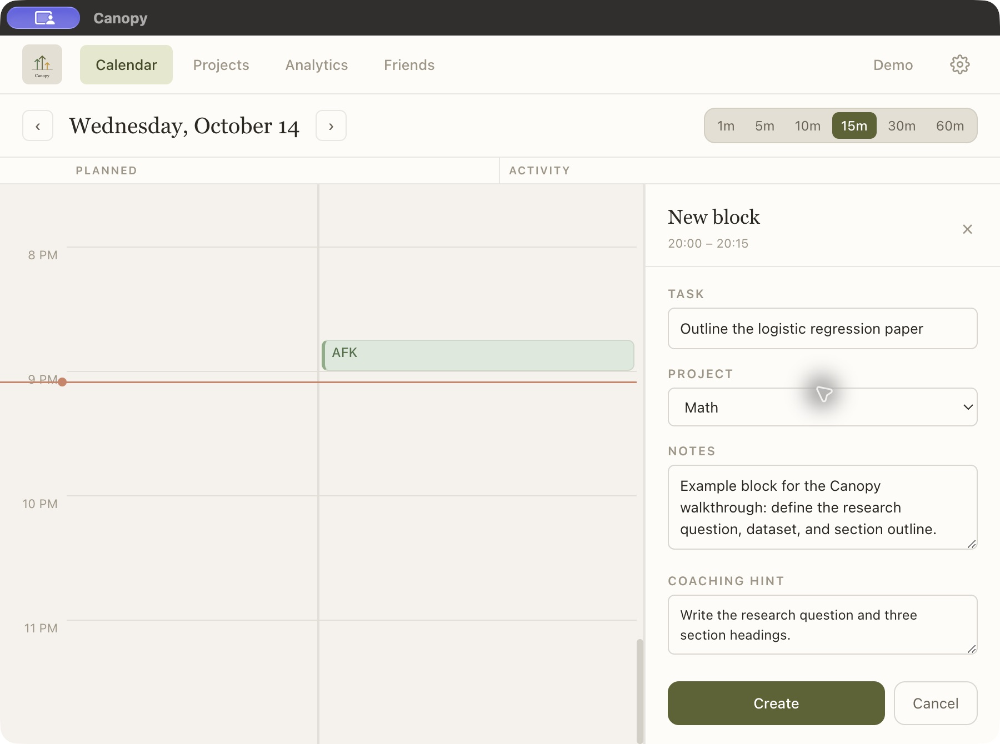
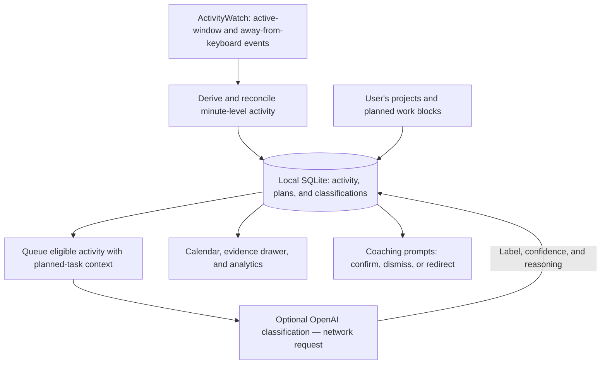

# Canopy

Canopy is a desktop prototype that helps students compare what they planned to work on with their actual computer activity. It combines a calendar planner, local activity processing, and optional AI classification to make drift visible and offer supportive prompts.

Built as a four-person Minerva University civic technology project during Fall 2025 and Spring 2026. **Status: macOS beta prototype.**

[Watch the walkthrough](https://youtu.be/KR-QFxVVcPA) · [Download the macOS beta](https://github.com/Muifrend/canopy/releases/tag/v1.0.0) · [Read the project process](docs/PROCESS.md)

[](https://youtu.be/KR-QFxVVcPA)

*Click the image to watch the walkthrough on YouTube. Current macOS beta with an example task staged for the walkthrough. See the [visual evidence gallery](assets/README.md) for project context and an earlier prototype.*

## Why We Built It

Students rely on their computers for coursework, research, and collaboration, but their activity can gradually drift away from the task they intended to complete. Total screen time alone does not explain whether that time served their goals.

Canopy explores the intention–execution gap by placing planned work beside observed activity. The design emphasizes awareness, inspectable evidence, and user choice: users can confirm that activity was relevant, dismiss a prompt, or redirect their plan.

Research, stakeholder input, and informal peer walkthroughs shaped the prototype. Feedback helped the team prioritize a calendar-based comparison, metadata-based activity analysis, and supportive coaching. The [process writeup](docs/PROCESS.md) explains the research and iterations in more detail.

## Project Context and Team

Canopy grew out of Minerva University's Digital Balance Cornerstone Civic Project across FE50 (Fall 2025) and FE51 (Spring 2026).

**Team:** Andrzej Firek, Hina Shahnaz Javed, Kreeshna Mehta, and Michael Masłowski.

I led much of the prototype implementation. The broader team contributed research synthesis, stakeholder communication, peer feedback, presentation design, and final deliverable writing. The [process writeup](docs/PROCESS.md) describes how these efforts shaped the product.

## What It Does

- **Plan work:** create projects and scheduled blocks with task descriptions and a next step.
- **Compare planned and actual activity:** see planned blocks alongside captured activity in a day view.
- **Inspect the evidence:** review activity metadata, classification reasoning, and model-reported confidence; manually confirm relevant work.
- **Reflect on patterns:** view daily and weekly activity summaries.
- **Respond to drift:** receive supportive prompts and choose whether to confirm, dismiss, or redirect.
- **Explore the product:** use the built-in Demo flow to tour the planner, activity lane, projects, analytics, and settings.

AI classification evaluates activity relative to the planned task. For example, a browser window can support research or distract from it; an app name alone is not enough to decide. Classification is an estimate that the user can review.

## How It Works

**Stack:** Electron, React, TypeScript, SQLite (`better-sqlite3`), ActivityWatch, and optional OpenAI classification.



The main engineering challenge is turning noisy window switches and idle periods into an understandable timeline while retaining evidence for review.

| Decision | Purpose |
| --- | --- |
| Reuse ActivityWatch for capture | Build on an existing activity tracker and focus on planning, interpretation, and feedback. |
| Derive minute-level records | Select the dominant app by duration, track away-from-keyboard streaks, and flag ambiguous records for review. |
| Reconcile recent activity and retain source events | Handle late activity data and support rebuilding derived records. |
| Persist a classification queue in SQLite | Process eligible activity asynchronously, retry failed requests, and retain the task context used for a decision. |
| Expose evidence and manual confirmation | Let users inspect and correct classifications rather than treating model output as authoritative. |
| Keep AI optional | Preserve planning and local activity tracking without an API key. |

The current classifier uses `gpt-4o-mini` and returns an on-task label, confidence, and a short explanation. Coaching uses local rules and message templates. For a task called “Draft the essay,” an off-task prompt can say: “Your recent activity does not look aligned with ‘Draft the essay’. Take the next small step on ‘Draft the essay’.”

Source entry points:

- [Activity capture](src/main/activitywatch/service.ts) and [minute derivation](src/main/pipeline/minute.ts)
- [Reconciliation pipeline](src/main/pipeline/service.ts) and [classification queue](src/main/db/classification-queue.ts)
- [Classification request and response parsing](src/main/classification.ts)
- [Coaching rules and messages](src/main/coaching/service.ts)
- [Electron main process and IPC](src/main/index.ts), [preload API](src/preload/index.ts), and [renderer](src/renderer/src/App.tsx)

See [architecture notes](docs/ARCHITECTURE.md) for more detail. Some supporting documents describe earlier prototype stages; the linked source files show the current implementation.

## Privacy and AI Data Flow

Planning, captured activity, and classification results are persisted locally in SQLite. ActivityWatch supplies active-window app names, window titles, and away-from-keyboard events. The current activity pipeline does not analyze screenshots, full webpage text, or every open browser tab.

**Local-first does not mean all processing stays on the device.** When OpenAI classification is enabled, requests send the app name, window title, dominance (the fraction of the minute spent in the dominant app), away-from-keyboard status, task title/description/next step, and project name/description. The optional project-description feedback feature also sends the project name and description to OpenAI.

Without an API key, planning and local tracking remain available. Automatic AI classification and classification-based drift prompts are unavailable; local away-from-keyboard prompts can still appear.

The beta stores an API key entered in Settings in a local `settings.json` file in Electron's user-data directory. It is not encrypted with the OS keychain.

## Status and Limitations

This repository presents an academic prototype and a macOS beta release. Informal feedback informed the design; classification accuracy, sustained usage, and effects on focus or well-being have not been established through a formal evaluation.

- The published [v1.0.0 beta](https://github.com/Muifrend/canopy/releases/tag/v1.0.0) is an **x64 macOS DMG** bundling ActivityWatch v0.13.2.
- The app is unsigned and not notarized, and has no in-app auto-update flow.
- Complete window-title tracking requires Accessibility permission for the bundled ActivityWatch app.
- Window metadata can be incomplete or ambiguous, and AI classifications can be wrong. Model-reported confidence is not measured classification accuracy.
- Social accountability is a “Coming soon” screen; mobile support and external integrations are future ideas.
- The release artifact and the current source branch may differ.

## macOS Beta Install

The macOS beta is available as a DMG through [GitHub Releases](https://github.com/Muifrend/canopy/releases/tag/v1.0.0).

1. Download `Canopy-1.0.0.dmg` from the [v1.0.0 release](https://github.com/Muifrend/canopy/releases/tag/v1.0.0).
2. Drag `Canopy.app` into `/Applications`.
3. For first launch, open Canopy from Terminal so macOS can surface both the Canopy and bundled ActivityWatch Accessibility prompts while logs are visible:

   ```bash
   /Applications/Canopy.app/Contents/MacOS/Canopy
   ```

4. Grant Accessibility permission when macOS prompts. Canopy may prompt first, but the bundled ActivityWatch watcher also needs its own Accessibility permission because it reads window titles.
5. If ActivityWatch does not prompt or window titles are missing, reveal the bundled ActivityWatch app and add it to **System Settings -> Privacy & Security -> Accessibility**, then quit and reopen Canopy:

   ```bash
   open -R /Applications/Canopy.app/Contents/Resources/resources/activitywatch/macos/ActivityWatch.app
   ```

6. Once Canopy opens, press the **Demo** button in the top navigation to see how the planner, activity lane, projects, analytics, and settings fit together.

Missing Accessibility permission for the bundled `ActivityWatch.app` can still allow app detection but prevent full window-title tracking. See [Status and Limitations](#status-and-limitations) for the beta's other constraints.

## Development

Install dependencies:

```bash
npm install
```

Run locally:

```bash
npm run dev
```

To enable optional OpenAI features, enter your API key in **Settings**. For local development, a repo-root `.env` file is also supported:

```bash
OPENAI_API_KEY=your_key_here
```

A saved key in Settings takes precedence over the `.env` key at startup. See [Privacy and AI Data Flow](#privacy-and-ai-data-flow) for what is sent to OpenAI and which features work without a key.

## Build

Typecheck and build the app:

```bash
npm run build
```

Build the macOS DMG:

```bash
npm run build:mac
```

`npm run build:mac` must run on macOS. It downloads the pinned ActivityWatch macOS release, stages the bundled ActivityWatch.app, and builds `dist/Canopy-<version>.dmg`.

Useful overrides:

```bash
ACTIVITYWATCH_VERSION=v0.13.2 npm run build:mac
MAC_BUILD_ARCH=x64 npm run build:mac
```

## Release

The GitHub Actions workflow at `.github/workflows/release-macos-dmg.yml` builds and publishes the private-beta DMG when a `v*` tag is pushed.

```bash
git tag -a v1.0.0 -m "Canopy v1.0.0"
git push origin v1.0.0
```

## Troubleshooting

- `ActivityWatch is not allowed assistive access`
  Add the bundled ActivityWatch app to macOS Accessibility:
  `/Applications/Canopy.app/Contents/Resources/resources/activitywatch/macos/ActivityWatch.app`

- `ActivityWatch not reachable`
  Check whether the local server is responding:

```bash
curl -sS http://localhost:5600/api/0/buckets
```

- `OPENAI_API_KEY missing or blank`
  Classification is disabled, but the planner still works.
