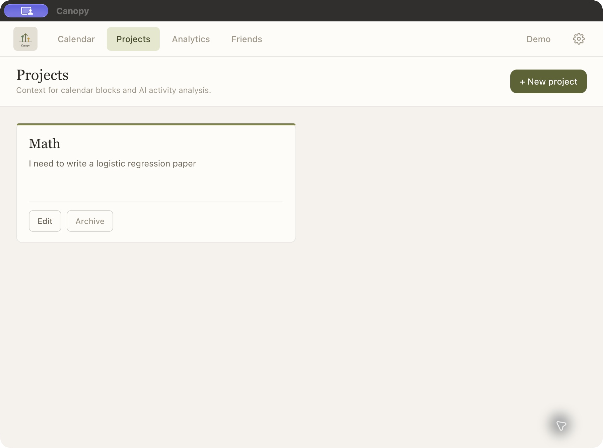
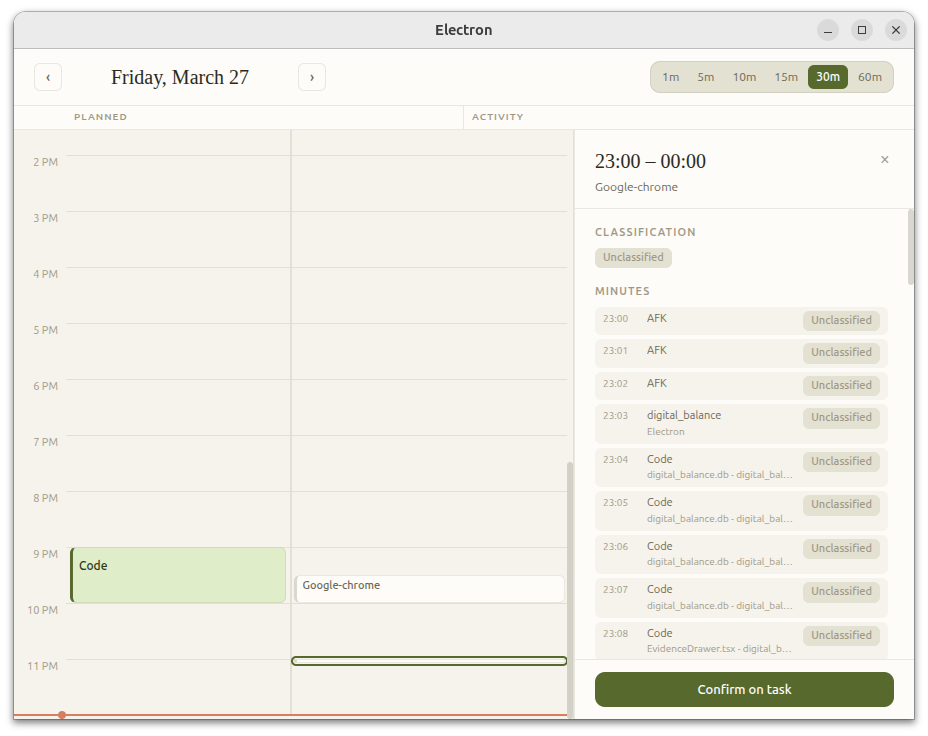

# Canopy visual evidence

These images document the current macOS beta and an earlier March 2026 prototype. They are original screenshots, without retouching or generated content.

## Current macOS beta

### Planning a task

Captured October 14, 2026 from the Intel macOS beta running through Rosetta. The task was staged as an example for the walkthrough. This shows the planning interface; it does not establish classification accuracy or user outcomes.

### Project context

Captured October 14, 2026. Projects provide context for planned work and optional AI classification.

## Earlier prototype: March 2026

Captured March 27, 2026. This earlier prototype shows activity inspection and the manual confirmation control. The visible records are unclassified. It is historical visual evidence, not the current release interface or evidence of successful AI classification.
